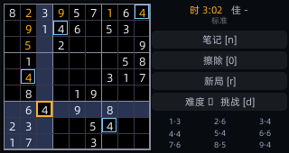
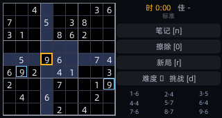
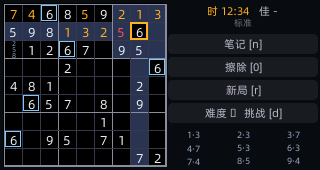

# SudokuZero 🧩

为 [M5Stack CardputerZero](https://cardputer.cc) 打造的数独游戏。
pygame 直写帧缓冲（RGB565 320×170）+ 裸 evdev 键盘输入，不依赖任何 UI 框架，与系统启动器无缝集成。

| 开局 | 中盘（笔记 + 错误标红） | 通关 |
|:---:|:---:|:---:|
|  |  |  |

图标为手绘软糖风设计（见 `docs/icon-design-reference.jpg`），由 `icon_gen3.py` 程序化复刻。

## 特性

- **唯一解谜题**：位掩码回溯生成全解 → 挖洞逐步唯一性校验，每局保证恰好一个答案
- **三档难度**：轻松 40 / 标准 32 / 挑战 26 提示数
- **笔记候选**：小字 3×3 候选标记，反复按同数字切换
- **即时反馈**：填错标红、同数高亮、行列宫淡高亮、每数字余数统计
- **计时纪录**：用时与最佳按难度分别保存于 `~/.local/share/sudokuzero/best.json`
- **合成音效**：振荡器生成短音，零素材；游戏内可直接调节系统音量
- **省电**：静止时主循环降到 5fps

## 按键

| 按键 | 功能 | 按键 | 功能 |
|---|---|---|---|
| `F` `X` `Z` `C` | ↑ ↓ ← →（键帽丝印） | `1`-`9` | 填数字（笔记模式写候选） |
| `0` / `Backspace` | 擦除 | `n` | 笔记模式开关 |
| `r` | 重开一局 | `d` / `Tab` | 切换难度 |
| `Fn+S` / `Fn+D` | 系统音量 +5% / -5% | `Fn+A` | 静音 |
| `Enter` | 对话框确认 | `Esc` | 退出 / 关闭对话框 |

## 安装

CardputerZero 上（或从 AppStore 输入分享码 `SDKU` 直达）：

```sh
sudo apt install ./sudokuzero_1.0.0_arm64.deb
```

安装内容：`/usr/bin/sudokuzero` 启动器、`/usr/share/sudokuzero/` 程序与字体、APPLaunch 图标入口。卸载：`sudo apt remove sudokuzero`。

## 从源码开发

```sh
python3 -m venv .venv && .venv/bin/pip install pygame   # Mac 本地
.venv/bin/python game.py --window    # 2× 放大窗口模拟器
.venv/bin/python test_game.py        # 逻辑冒烟测试
```

构建 `.deb`（在任何 Debian 系机器上，如另一块开发板）：

```sh
tar czf pkg.tar.gz --exclude='._*' -C pkg .   # pkg/ 为组装好的目录树
mkdir build && tar xzf pkg.tar.gz -C build
dpkg-deb --build --root-owner-group build sudokuzero_1.0.0_arm64.deb
```

> 重新生成运行时字体子集需要完整版阿里巴巴普惠体（设备上位于
> `/usr/share/APPLaunch/share/font/AlibabaPuHuiTi-3-55-Regular.ttf`），
> 图标生成需要 Noto Sans CJK（设备同目录）。`charset.txt` 为子集字符集。

## 许可证

代码 [MIT](LICENSE)；字体许可见 [assets/FONT-LICENSES.md](assets/FONT-LICENSES.md)。
